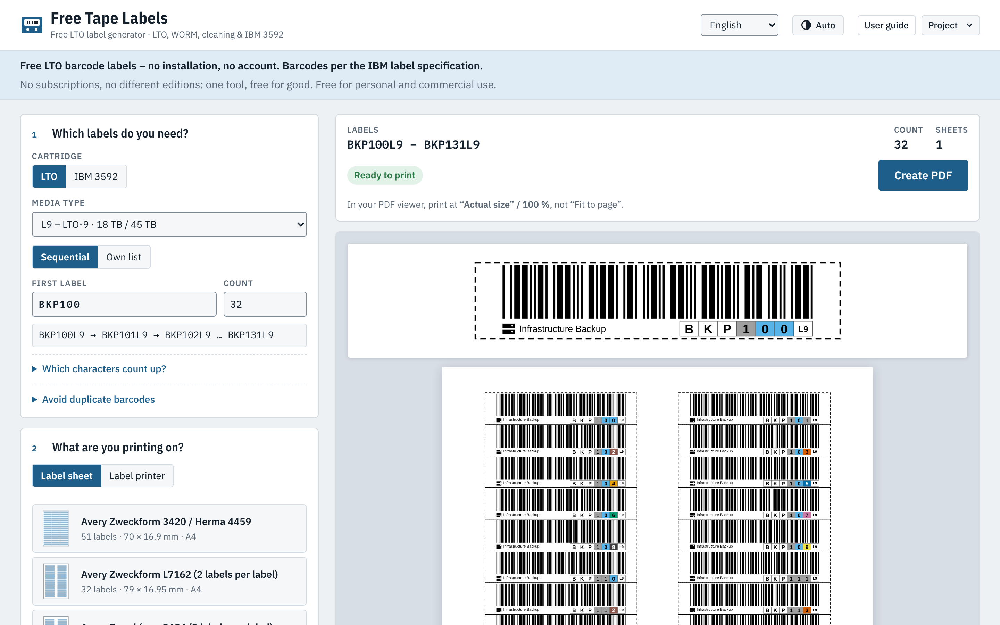

# Free Tape Labels

**Free, browser-based LTO barcode label generator.** No account, no install, no subscription.

**Live:** https://www.freetapelabels.com



## Features

- **LTO-1 to LTO-10** (incl. LTO-10 40 TB), **WORM**, **cleaning cartridges** and **IBM 3592**, plus your own 2-character media code
- **Code 39 barcodes per the IBM label specification**: 6-character VOLSER + 2-character media ID; bar widths, quiet zones and height are checked before you print
- **Templates** for common label sheets (Avery 6571/6577, OnlineLabels OL173, WorldLabel WL-173, Avery Zweckform 3420/Herma 4459 and more) and for **label printers** (Zebra, Brother QL), or define your own sheet with a live dimension overlay
- **Duplicate check**: paste or import your tape inventory (CSV from Veeam, Backup Exec or your library) and get a warning before you print a barcode that already exists
- **Printer calibration** with a ruler, or without one: fold the test sheet and read the offset off the scale
- Colour-coded characters (default palette is colour-blind friendly, classic LTO colours available), optional description, icon or company logo
- Sequential ranges or your own list, start on a partially used sheet, save/load projects as JSON
- 8 languages (English, German, French, Spanish, Italian, Portuguese, Dutch, Polish), light/dark mode, keyboard accessible, works on desktop and phone

## Privacy

Everything runs locally in your browser. Labels, lists and logos are never uploaded. The site sets no cookies and loads all fonts and libraries from its own server.

## Self-hosting

The website consists of static files only, no server-side code and no database.

1. Download the ZIP from the latest [release](../../releases), or build it yourself (see below).
2. Upload the contents of `dist/` to any static web host (Cloudflare Pages, Netlify, GitHub Pages, nginx, Apache, IIS …), or serve it on your intranet.

Before hosting a public copy:

- Replace the legal texts (privacy policy, terms of use, contact) in `src/free-tape-label.html` with your own. They name the operator of freetapelabels.com.
- Do not present your copy as the official Free Tape Labels site.
- If you modify the code and make it available to others over a network, the AGPL-3.0 requires you to offer them the source code of your version (see [License](#license)).

## Building

Requirements: **Python 3.8+**. No other dependencies.

```sh
python3 tools/build_site.py                                   # builds dist/ for www.freetapelabels.com
python3 tools/build_site.py --base https://labels.example.com/ # builds for your own domain
```

To test locally, serve `dist/` with any web server, for example:

```sh
cd dist && python3 -m http.server 8000
```

## Project structure

| Path | Content |
|---|---|
| `src/free-tape-label.html` | The complete app: markup, styles, script and all translations |
| `public/` | Static files copied unchanged into `dist/` (fonts, jsPDF, favicon, preview image) |
| `tools/build_site.py` | Builds one pre-translated page per language, plus sitemap, robots.txt and `_headers` |
| `dist/` | Build output (not committed) |

### Translations

English is the source language: all texts in `src/free-tape-label.html` are written in English, and the English text is the key in every dictionary. The translations (`DE`, `FR`, `ES`, `IT`, `PT`, `NL`, `PL`) are one-line JSON objects near the top of the script. A new or changed UI string needs an entry in every dictionary.

Translation improvements by native speakers are very welcome, especially for the legal texts.

## Contributing

Bug reports, missing label sheets, printer models and translation fixes are very welcome. Please open an [issue](../../issues) first.

Pull requests can only be merged after you agree to the [Contributor License Agreement](CLA.md). See [CONTRIBUTING.md](CONTRIBUTING.md).

## Support the project

The tool stays free. If it saves you time and money, you can [buy me a coffee on Ko-fi](https://ko-fi.com/freetapelabels).

## Contact

freetapelabels@proton.me

## License

Copyright © 2026 Free Tape Labels

This program is free software: you can redistribute it and/or modify it under the terms of the **GNU Affero General Public License version 3** as published by the Free Software Foundation. See [LICENSE](LICENSE).

This program is distributed in the hope that it will be useful, but WITHOUT ANY WARRANTY; without even the implied warranty of MERCHANTABILITY or FITNESS FOR A PARTICULAR PURPOSE.

Third-party components and their licenses are listed in [THIRD-PARTY-NOTICES.md](THIRD-PARTY-NOTICES.md).

For other licensing arrangements, contact freetapelabels@proton.me.
